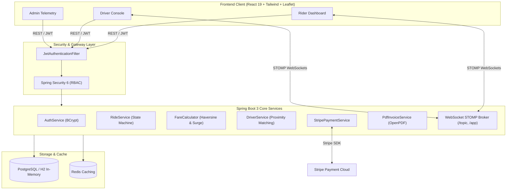
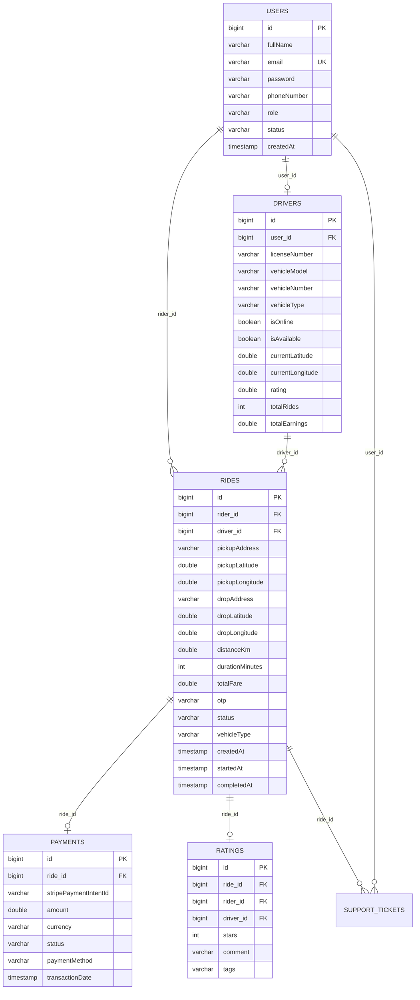

# 🚖 Cab Booking Enterprise Application (Uber Clone)

[](https://openjdk.org/)
[](https://spring.io/projects/spring-boot)
[](https://spring.io/projects/spring-security)
[](https://docs.spring.io/spring-framework/reference/web/websocket.html)
[](https://www.postgresql.org/)
[](https://stripe.com)
[](https://react.dev)
[](https://www.docker.com/)

An **industry-grade, full-stack ride-hailing simulation platform** built on enterprise Java and modern React architecture. It mirrors production systems like **Uber, Lyft, and Ola**, complete with geospatial driver dispatching, STOMP WebSockets for real-time tracking, Stripe payment gateway, automated PDF invoice generation, emergency SOS broadcasting, and administrative telemetry.

---

## 📌 Resume Highlights & Architectural Impact

> **Designed for your Resume as a Flagship Major Project:**
> - **Enterprise Backend:** Spring Boot 3, Spring Data JPA/Hibernate, Spring Security 6 with stateless JWT authentication and Role-Based Access Control (`ROLE_RIDER`, `ROLE_DRIVER`, `ROLE_ADMIN`).
> - **Real-Time System Design:** Implemented bi-directional messaging with Spring WebSocket (STOMP broker), enabling live GPS coordinate broadcasting, ride status state machines, and low-latency SOS emergency dispatch.
> - **Geospatial & Pricing Engine:** Haversine coordinate distance computation, dynamic surge multipliers based on peak demand, vehicle category pricing (Economy, Comfort, Premier, XL), and promo code discounts.
> - **FinTech & Document Generation:** Integrated Stripe Java SDK for PaymentIntent lifecycle management, webhook handling, and dynamic downloadable PDF tax receipts using OpenPDF.
> - **DevOps & Containerization:** Multi-stage Docker builds, PostgreSQL containerization with persistent volumes, and GitHub Actions automated CI/CD pipeline.

---

## 🏗️ System Architecture



---

## 🗄️ Database Design (Relational Schema)



---

## ⚡ Key Features

| Feature | Technology | Capabilities |
| :--- | :--- | :--- |
| **Authentication & RBAC** | Spring Security + JWT | BCrypt password hashing, role-based endpoint protection (`RIDER`, `DRIVER`, `ADMIN`), 1-click evaluator demo logins. |
| **Ride Booking & Lifecycle** | Spring Boot + JPA | State machine: `REQUESTED` ➔ `ACCEPTED` ➔ `DRIVER_ARRIVED` ➔ `IN_PROGRESS` ➔ `COMPLETED` / `CANCELLED`. |
| **Geospatial & Pricing** | Custom Haversine Engine | Distance calculations, ETA estimation, rush hour surge multipliers, dynamic vehicle tier pricing. |
| **Real-time WebSockets** | STOMP + SockJS | Live GPS position broadcasting (`/topic/driver-location/{rideId}`), ride updates, emergency SOS alert broadcast (`/topic/sos-alerts`). |
| **Driver OTP Security** | SecureRandom PIN | 4-digit ride verification PIN required from rider before trip commencement. |
| **Stripe Payments** | Stripe Java SDK | PaymentIntent creation, mock/live payment confirmation, webhook processor, and fallback sandbox simulator. |
| **PDF Invoicing** | OpenPDF / iText | Generates downloadable branded PDF trip tax invoices with itemized fare breakdown. |
| **Google Maps Integration** | Google Maps JavaScript API + Places & Directions | Native Google Maps roadmap & satellite views, turn-by-turn route plotting with `DirectionsRenderer`, Street View pegman, live traffic layer, and custom API key configuration. |
| **Interactive Map UI** | Google Maps / OpenStreetMap | Dual-engine toggle (Google Maps 🌐 & OpenStreetMap 🌍), dynamic route polyline, pulsating location beacon, rotating car markers, click-on-map coordinate picker. |
| **Admin Analytics** | React + Spring Boot | Real-time platform KPI telemetry (Revenue, completed trips, active drivers, customer satisfaction), user moderation, and dispute resolver. |

---

## 🚀 Quick Start Guide

### Option 1: Instant 1-Click Run on Windows (Zero Setup)
Double-click `run.bat` in the project root:
```cmd
run.bat
```
This automatically verifies the JDK, launches Spring Boot with the bundled React Single-Page Application, and opens `http://localhost:8080` in your default browser!

---

### Option 2: Docker Compose (Full Stack with PostgreSQL & Redis)
Ensure Docker Desktop is running, then execute:
```bash
docker compose up --build
```
- Web Application: [http://localhost:8080](http://localhost:8080)
- PostgreSQL Database: `localhost:5432` (`cab_booking_db`)
- Redis: `localhost:6379`

---

### Option 3: Manual Step-by-Step Run

#### 1. Backend (Spring Boot)
```bash
cd backend
mvn spring-boot:run
```
*Backend runs on `http://localhost:8080`*

#### 2. Frontend Development Mode (Hot-Reloading)
```bash
cd frontend
npm install
npm run dev
```
*Frontend runs on `http://localhost:5173`*

---

## 🔑 Pre-Seeded Demo Accounts for Evaluators

You can log in manually or use the **Demo Switch** in the top navigation bar for 1-click access:

| Role | Email | Password | Details |
| :--- | :--- | :--- | :--- |
| **Rider (Passenger)** | `rider@uber.com` | `rider123` | Active rider with pre-loaded trip history & invoice downloads |
| **Driver 1 (Sedan)** | `driver.john@uber.com` | `driver123` | Toyota Camry Hybrid, 4.92 ★, $1,850 earnings |
| **Driver 2 (Electric)**| `driver.sarah@uber.com` | `driver123` | Hyundai Ioniq EV, 4.88 ★, Economy |
| **Driver 3 (XL SUV)** | `driver.mike@uber.com` | `driver123` | Chevrolet Suburban XL, 4.98 ★ |
| **Admin** | `admin@uber.com` | `admin123` | Full access to KPI telemetry, user moderation, dispute resolution |

**Active Promo Codes:** `FIRST50` (50% off up to $15), `UBER20` (20% off), `SUMMER25` (25% off)

---

## 📚 REST API & Documentation

Interactive OpenAPI / Swagger documentation is available at:
👉 **[http://localhost:8080/swagger-ui/index.html](http://localhost:8080/swagger-ui/index.html)**

### Core API Endpoints

```http
# Authentication
POST /api/auth/login                  # Authenticate and receive JWT
POST /api/auth/register               # Register new rider or driver
GET  /api/auth/me                     # Get authenticated user profile
POST /api/auth/demo-login/{role}      # Instant test login (rider|driver|admin)

# Rides & Pricing
POST /api/rides/estimate              # Calculate distance, duration & fare tiers
POST /api/rides/book                  # Request a ride with OTP generation
GET  /api/rides/{id}                  # Fetch ride details
POST /api/rides/{id}/accept           # Driver accepts ride
POST /api/rides/{id}/arrived          # Driver arrives at pickup
POST /api/rides/{id}/start            # Verify OTP and start ride
POST /api/rides/{id}/complete         # Complete ride and trigger payment
POST /api/rides/{id}/cancel           # Cancel active trip
GET  /api/rides/active                # Get active ride for current session
GET  /api/rides/{id}/invoice          # Download branded PDF receipt

# Driver Dispatch & Tracking
GET  /api/drivers/profile             # Driver ratings & earnings
PUT  /api/drivers/status              # Toggle online/offline
PUT  /api/drivers/location            # Update GPS coordinates
GET  /api/drivers/nearby              # Query available drivers by radius

# Payments & Ratings
POST /api/payments/create-intent      # Create Stripe PaymentIntent
POST /api/payments/confirm            # Confirm Stripe / card payment
POST /api/ratings                     # Submit 1-5 star review & feedback tags

# Admin & Safety
GET  /api/admin/metrics               # Platform telemetry KPIs
GET  /api/admin/users                 # Moderate platform users
PUT  /api/admin/users/{id}/toggle-status # Suspend/activate user account
POST /api/support/sos                 # Emergency SOS broadcast
```

---

## 📝 How to Present This on Your Resume

### Project Entry (Software Engineer / Backend Developer)

**Cab Booking Enterprise System (Uber Clone) | Java, Spring Boot, PostgreSQL, WebSockets, React**
- Engineered an enterprise ride-hailing platform using **Spring Boot 3**, **Spring Security (JWT)**, and **PostgreSQL**, processing dynamic fare estimates across multiple vehicle tiers with surge multipliers.
- Built a real-time tracking and event pipeline using **Spring WebSocket (STOMP)**, broadcasting low-latency driver GPS telemetry and emergency SOS alerts.
- Integrated **Stripe Java SDK** for payment processing with automatic fallback simulation and created automated downloadable **PDF tax invoices** via OpenPDF.
- Designed geospatial driver proximity matching utilizing the **Haversine formula**, improving dispatch efficiency.
- Containerized the full-stack architecture with multi-stage **Dockerfiles**, **Docker Compose**, and automated validation via **GitHub Actions CI/CD**.
